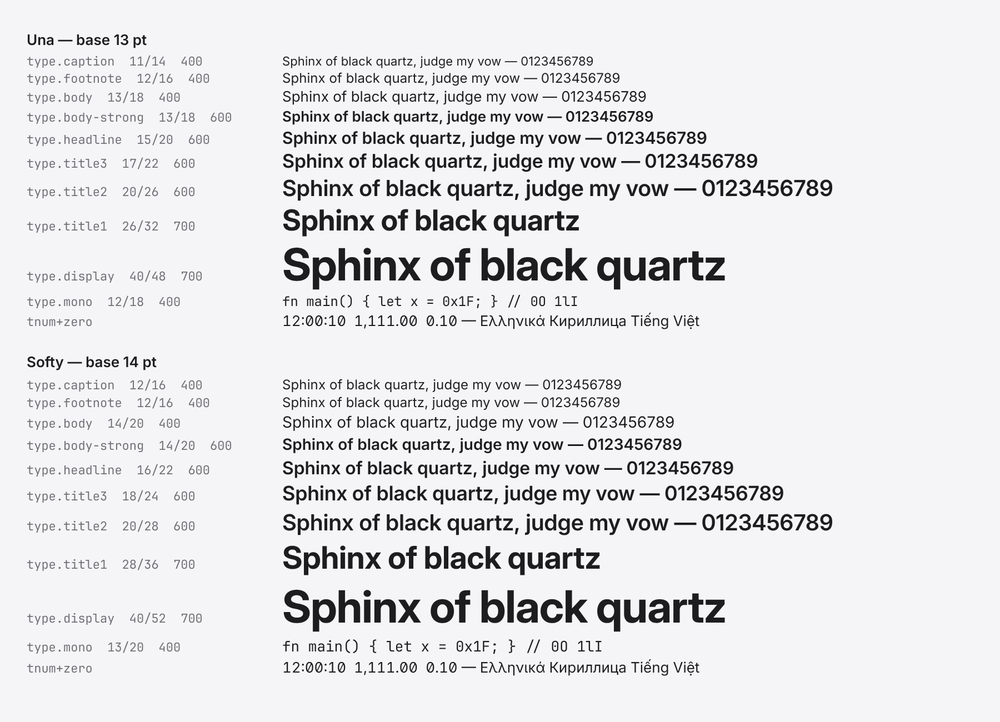

# FONTSCRAFT — Inter, JetBrains Mono and Noto Sans at their best (rmbp-ledger B640, R124)

Peter, R124 (RULINGS.md:155): "6 make it the best." DESIGN-LANGUAGE §2.2 names the faces, the ramp and what the
raster needs. This arc delivers all of it on the host, and the next metal boot is where it is seen. R78 applies: no
QEMU and no metal in this arc. The ramp below was drawn on the host by the same `font_core::ui::Engine` that
`video::text` drives.



`ramp.png` is 1800x1300 at scale 2.0, with Inter, JetBrains Mono and Noto Sans from `fonts/` and DejaVu Sans from
the host. It was written by `tests/fontscraft.rs::ramp_png` and then re-encoded at zlib level 9 with the same pixels.

## 1. The faces (vendored, pinned, staged)

| file in the tree | release | bytes | sha256 (= `unaos/firmware/fonts.pins`) | licence |
|---|---|---|---|---|
| `fonts/inter/InterVariable.ttf` | Inter 4.1 (`Inter-4.1.zip`), axes `opsz` 14–32, `wght` 100–900 | 879708 | `4989b125…278d0ccaf` | OFL 1.1, `fonts/inter/LICENSE` |
| `fonts/jetbrains-mono/JetBrainsMono-Variable.ttf` | JetBrains Mono 2.304, `fonts/variable/JetBrainsMono[wght].ttf`, `wght` 100–800 | 303144 | `662a196d…8cac016` | OFL 1.1, `fonts/jetbrains-mono/LICENSE` |
| `fonts/noto-sans/NotoSans-Variable.ttf` | Noto Sans 2.015, `unhinted/slim-variable-ttf/NotoSans[wght].ttf`, `wght` 400–700 | 712460 | `fb53504d…e13547b` | OFL 1.1, `fonts/noto-sans/LICENSE` |

The archive digests and the member paths are in `fonts.pins`'s header. The zips were downloaded into
`~/unaos-bench/scratch/rmbp-0915/local3/fontscraft/dl/`, which held data only.

- **Builder** (`unaos/builder/src/main.rs`): `KFONT_FACES` gains the three files. `kfont_tree_dirs()` searches
  `<repo>/fonts/<family>/` after `UNAOS_FONT_DIRS` and before the host's packages. `kfont_pins()` reads
  `firmware/fonts.pins`. A pinned face is staged only when its digest matches the pin. On a mismatch the builder
  prints `FONTS: <file> sha256=… != pin … — NOT staged`. Each family's `LICENSE` is staged as
  `system/fonts/LICENSES/<family>.txt`, and every staged face gets a row in `MANIFEST.txt`. Both the ESP and the
  DATA volume get the faces, as KERNELFONT's faces already did.
- **arroyo**: `kfont_tree_pins` runs first in `ensure_kfont_noto`, which runs before every media build. It prints
  `⚡ FONTS: fonts/ vs firmware/fonts.pins -> MATCH (Inter + JetBrains Mono + Noto Sans, 1895312 B per volume; FONTSCRAFT B640)`.
  This line was measured by running the function in isolation on this tree.
- **Image-size impact**: each volume that carries `system/fonts` grows by 1,895,312 B of faces plus 13,175 B of
  licences, so **+1,908,487 B (1.82 MiB) per volume**. There are two such volumes (ESP and DATA), so 3.64 MiB per
  image. The card's p1 does not carry `system/` (R99), so on the UnaFS card only p2 grows. The kernel keeps the
  faces it parses resident. With Inter and JetBrains Mono loaded it skips the two DejaVu Sans Mono faces (677,408 B
  on this host's DejaVu), so resident font bytes grow by **+1,217,904 B (1.16 MiB)** of heap.

## 2. `font_core` (unaos/libs/text/font_core)

- **`src/var.rs` (new):**
  - `Fvar`: axes. `normalize` does the default normalization, rounds to F2Dot14, applies `Avar` segment maps (v1
    maps, also from a v2 table), and rounds again.
  - `ItemVariationStore`: 16/8 and 32/16 rows, plus `region_scalar`.
  - `DeltaSetIndexMap`: formats 0 and 1.
  - `Hvar`: advance deltas.
  - `Gvar`: shared and embedded peaks, intermediate regions, shared and private packed points, packed deltas
    (zero, byte, word and long runs), IUP per contour, and phantom points.
  - Malformed tables yield no deltas, never a panic.
- **`Font`**:
  - Variation tables are `fvar`, `avar`, `gvar`, `HVAR`, and the `GDEF` 1.3 store as `layout_store`.
  - Each `Font` holds `coords: [f32; 8]`, so an instance is still a `Copy` struct.
  - New methods: `set_variation`, `with_variations`, `reset_variations`, `axes`, `has_axis`, `coords`,
    `is_instanced`, `variation_value` and `device_delta`.
  - `advance()` adds the `HVAR` delta, or the phantom-point delta when there is no `HVAR`.
  - `outline()` goes through `Glyf::outline_var`. Simple glyphs get point deltas with inferred untouched points.
    Composites get component-offset deltas. Both shift by the phantom-1 delta, as FreeType does.
  - The default instance takes the old code path byte for byte.
- **GPOS at an instance**: `read_value_var` / `pair_adjust_var` add VariationIndex deltas to ValueRecord device
  fields. `anchor_var` does the same for Anchor format 3 device offsets. Inter's AV kern is -140 units at 400 and
  -162 at 700.
- **Features**: `Plan::new(…, extra)` and the new `shape_run_with` / `shape_fallback_with` turn on user features
  in the last stage. `ui::Style::features` takes `FEAT_TNUM`, `FEAT_ZERO`, `FEAT_SS01`, `FEAT_SS02`, `FEAT_CV01`,
  `FEAT_CV05`, `FEAT_CV08` and `FEAT_CASE`. `kern`, `liga` and `calt` stay on by default.
- **`ui::Engine`**:
  - `Style` gains `weight`, `features` and `tracking` (em), plus `Style::new` and builder methods.
  - Variable slots are instanced per draw. `wght` comes from `Style::weight`, or `bold_weight` = 600 when `bold`
    asks a variable slot for a weight it was not loaded at.
  - `opsz` is the size in pt, set through `set_px_per_pt`.
  - New `Role::Fallback`. The stack is primary → sans → Fallback faces of that weight (a variable fallback serves
    both weights) → script faces.
  - The glyph cache is split into **per-role atlases**, keyed by (role, bold, weight, size), at most 12, under one
    byte bound. An overflow drops whole atlases, least recently used first.
  - New: `baseline_in_line`, `primary_instance`, `primary_name`, and `Stats::atlases`.
- **Hinting**: `rasterize_glyph_hinted` draws an instanced face unhinted. The auto-hinter reads the default
  master's points.

## 3. Kernel

- **`video/theme.rs`** (type-role table only):
  - `TypeRole`, `TypeStep` and `TYPE_RAMP` follow §2.2 row for row, with (Una, Softy) steps.
  - `TYPE_BASE_PT = (13, 14)`.
  - `type_role(role, softy)` and `TypeStep::tracking_em()`.
  - The table is appended at the file's tail, so no earlier line moves.
- **`video/text.rs`** (the seam `font_core::ui` names; see §6 on the lane):
  - `FACES` is Inter (Sans), JetBrains Mono (Mono), Noto Sans (Fallback), DejaVu Sans and Sans Bold (Fallback, or
    the Sans stand-ins when Inter did not load), DejaVu Sans Mono (read only when JetBrains Mono did not load),
    DejaVu Serif, and the four Noto script faces.
  - The volume is found by `InterVariable.ttf` or `DejaVuSans.ttf`.
  - `restyle` sets px-per-pt from the dpi scale. Witness names come from the loaded slots, no longer hard-coded
    `dejavu-*`.
  - New `Face::Title`: `type.title2` of the look on the glass (20/26 pt Una, 20/28 Softy, `wght` 600, -0.75 %
    tracking). Its cell is `title_cell()`, the line height at the dpi scale. Its bitmap fallback is the chrome atlas.
  - A new witness line follows the `[kfont] load` line.
- **`system.display.font`** stays the Principia schema's enum `sans | serif | mono`, default `"sans"`. `sans` now
  draws Inter, so the default is Inter with no schema change and no dotfile (head item 11).

## 4. Proof (host)

| leg | command | result |
|---|---|---|
| font_core compile | `cargo check -p font_core --tests` (repo root) | rc=0, no warnings |
| kernel x86 compile | `cd unaos`, the bench line (`UNAOS_WIFI_FW_PATH=…/broadcom-b43; set -a; . ./scripts/image-line.env; set +a; export UNAOS_AETHER=1 UNAOS_MIDDEN=1 UNAOS_UNA=1 UNAOS_SONDE=1`), then in `crates/kernel`: `cargo +nightly check --release --target ../../x86_64-unknown-none.json $NIGHTLY_FLAGS --features "<the banner's 60 features: witness,…,wc,…,lumen,…,ioapic>"` | rc=0, 1m11s; 104 warnings, none in `text.rs` / `theme.rs` / `font_core` |
| builder compile | `cd unaos/builder && cargo +nightly check --release --tests` | rc=0 |
| font_core tests, run 1 | `FONTSCRAFT_ORACLE_DIR=<dl>/oracle FONTSCRAFT_RAMP_PNG=… cargo test -p font_core -- --nocapture` | rc=101: 28 passed, 1 failed. **`tests/fontscraft.rs` 6/6 ok.** It stopped at `tests/kat.rs::tables_match_fonttools`: "no KAT font available on this host" |
| font_core tests, run 2 (the binaries run 1 did not reach) | `cargo test -p font_core --no-fail-fast --test kernelfont --test linebreak --test name --test oracle --test raster --test shape --test text_units` | rc=101: 26 passed, 2 failed. **`kernelfont` 11/11 ok** (the engine change against KERNELFONT's contract). `name_records_match_fonttools` and `raster::coverage_integrates_to_the_outline_area` failed |

**The three failures are host-environmental, not this arc.** Each test SKIPs every font whose sha256 differs from
the container fonts its KAT was generated from. The log shows `SKIP …DejaVuSans.ttf: sha256 differs from the KAT
source` for every DejaVu file. Each test then asserts that at least one font was checked. None of the three reaches
a variable face or the engine. They would fail the same way at the baseline on this host. That baseline was not run,
because one test run was allowed.

**What `tests/fontscraft.rs` proved:**

- **Axes.** Inter has `opsz` 14/14/32 and `wght` 100/400/900, plus `avar`, `gvar`, `HVAR` and a GDEF store.
  `wght` 900 normalizes to 1, 100 to -1 and 400 to 0, and values clamp. 600 normalizes to 0.3600 through `avar`.
  JetBrains Mono is `wght` 100–800 and Noto Sans is 400–700.
- **Instancing.**
  - The default instance has paths and advances identical to the stored face.
  - Ink grows with `wght` across "Hamburgefonstiv": Inter 'n' area is 133511 at 100, 472776 at 400 and 745220
    at 700.
  - `HVAR` widens the advances: 'n' is 1210 units at 400 and 1275 at 700.
  - The composite é widens and keeps its contours.
  - `opsz` 32 sets tighter: 15372 units for the word against 16746 at opsz 14.
  - JetBrains Mono keeps its 600-unit cell at 800 while its ink grows.
  - Noto Sans varies.
- **Oracle**, opt-in: the release's static `Inter.ttc` and `JetBrainsMono-Bold.ttf` against the variable faces at
  the same coordinates.

  | static face | glyphs | advance within 1 unit | bbox within 1.5 units |
  |---|---|---|---|
  | Inter Bold | 94 | 94 | 93 |
  | Inter Light | 94 | 94 | 94 |
  | Inter Display SemiBold | 94 | 94 | 93 |
  | Inter Display Black | 94 | 94 | 93 |
  | JetBrains Mono Bold | 94 | 94 | 94 |

  The one box per Inter face outside the tolerance is consistent with the static faces having their overlaps
  removed.
- **Features.**
  - `tnum` puts every figure on one advance.
  - `zero` gives a different glyph (the slashed zero, visible in the ramp).
  - AV is kerned at 400 and at 700.
- **Engine.**
  - The fallback chain: U+0149 falls to Noto Sans and U+03E2 to DejaVu Sans.
  - `opsz` comes from the pt size: 13 pt clamps to 14, 40 pt clamps to 32, and 20 pt lands inside the axis.
  - `bold` on a variable slot gives the 600 coordinates and measures wider.
  - Tracking adds 0.01 em per glyph exactly.
  - `tnum|zero` gives figures one advance.
  - Three roles make three atlases, and the body redrawn after a 40-pt and an 80-pt draw has **0 new misses**.
  - A 48 KiB budget stays under its bound and drops whole atlases.
- **Ramp.** All 24 rows put ink on the canvas.

## 5. The next boot's wire (expected, not seen; metal or the QEMU fold)

```
[kfont] load dir=/system/fonts faces=11/13 fallback=none scripts_missing=none font_kib=… … body=jetbrains-mono-… chrome=inter-… ui=inter-… console=jetbrains-mono-… ms=…
[font] face=Inter file=InterVariable.ttf axes=opsz:14-32,wght:100-900 ui=<px> wght=400.0 opsz=<pt, 14.0..32.0> bold_wght=600 mono=jetbrains-mono chain=inter>noto-sans>dejavu-sans>font8x8 title=<20 x scale>/<26 x scale>@600 look=una base_pt=13 features=kern,liga,calt+tnum,zero,ss01,ss02,cv01,cv05,cv08,case-on-request atlases=per-role reason=ok
:: KERNELFONT: faces=11 … fallback=none … -> PASS ::
```

At scale 2.0 in the Una look, `title=40.0/52@600`. The count `faces=11/13` is the 13 `FACES` rows minus the two
DejaVu Sans Mono rows, which are skipped when JetBrains Mono loads. An image built without `fonts/` (an older tree)
prints `face=DejaVu … reason=inter-absent+jetbrains-absent` and draws KERNELFONT's set in the same roles.

## 6. Owed, and the lane

- **The lane named `video/font.rs`.** That file is the pre-heap bitmap atlas (`noto-sans-mono-bitmap`). The faces,
  `system.display.font` and the fallback chain live in `video/text.rs`, the seam `font_core::ui` names. The arc
  edits `text.rs` and leaves `font.rs` untouched; font8x8 stays the chain's last step.
- **The lane also did not name `builder/src/main.rs`.** The brief's "make the builder put them on the image" is
  only possible there: `KFONT_FACES`, tree dirs, pins, and the test's Noto count.
- **SETTINGSCRAFT's "title-size face".** The face exists (`text::Face::Title`). Its one consumer line is outside
  the lane: `video/settings.rs:844` `let tf = super::text::Face::Chrome;` → `super::text::Face::Title;`. The title
  cell is 26 logical px, which is ≤ `PANE_Y` = 60, so the centring arithmetic holds. GLASSKIT.md's "title-size
  face" bullet then closes.
- **`tnum` callers.** Clock, meters and Activity can now ask for `tnum`, but none of those callers is in this
  lane.
- **Not read:**
  - `MVAR`: line metrics stay the default master's.
  - GSUB `FeatureVariations` (`rvrn` substitutions, e.g. Inter's heavy-weight alternates).
  - `avar` v2's extra store.
- **Hinting.** A variable instance is never hinted. §2.2 wants none at scale ≥ 2.
- **Knob-off.** `text.rs`'s `Face` enum and `title_cell` are unconditional code, so the knob-off verdict is the
  seat's (`./arroyo knoboff`).
- **`Engine::set_px_per_pt`** counts one flush even on an empty cache. This is cosmetic: `flushes: 1, evictions: 0`
  in the engine line above.
